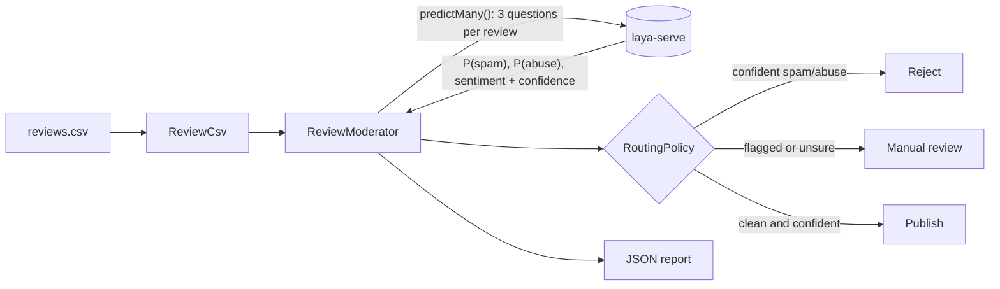

# Review Moderator CLI

Self-hosted review moderation for PHP: every product review is classified for **spam**, **abuse** and
**sentiment** by [Laya](https://github.com/NandhaKishorM/laya) through
[LayaPHP](https://github.com/marcreichel/laya-php), then routed to **publish**, **manual-review** or **reject**.
No LLM API, no per-call fees: the model runs on your own server, and every answer comes with a calibrated
confidence that decides when a person has to look.

> Project 1 of 5 in my [LayaPHP learning roadmap](../ROADMAP.md).

## Why not just ask an LLM?

| | Generative LLM API | Laya (this project) |
|---|---|---|
| Output | free text you have to parse | typed answers: P(yes), a label, a level |
| Off-menu answers | possible | impossible — it only scores the options you give |
| Confidence | a number the model *writes* | calibrated probability from a single forward pass |
| Cost | per token, per call | your own CPU/GPU, unlimited calls |
| Data | leaves your infrastructure | stays on your server |

## How it works



Each review gets three typed questions in one request ([`ReviewQuestions`](src/ReviewQuestions.php)):
`spam` (yes/no), `abuse` (yes/no) and `sentiment` (positive / neutral / negative).
[`RoutingPolicy`](src/RoutingPolicy.php) turns the answers into a decision:

| Rule (defaults) | Decision |
|---|---|
| P(spam) or P(abuse) ≥ **0.9** *and* that answer's confidence ≥ **0.7** | `reject` |
| P(spam) or P(abuse) ≥ **0.5**, or any answer confidence < **0.7** | `manual-review` |
| otherwise | `publish` |

The asymmetry is deliberate: automation only acts when Laya is sure, everything in between goes to a person.
A high probability that Laya itself doesn't trust (low `answerConfidence`) is never enough to reject.

## Quick start

Requires PHP 8.4+ and Composer.

```bash
composer install
composer check                                  # pint + phpstan (max) + pest — no server needed

php bin/moderate ../datasets/reviews.csv --fake # smoke test with canned answers
```

Real decisions need a running `laya-serve` (see [`../vps/SETUP.md`](../vps/SETUP.md)):

```bash
docker compose -f ../vps/compose.yaml up -d --wait
php bin/moderate ../datasets/reviews.csv
php bin/moderate ../datasets/reviews.csv --model=multilingual --min-confidence=0.8
php bin/moderate ../datasets/reviews.csv --single   # one request per review, to time single calls
```

| Option | Default | |
|---|---|---|
| `--url` | `$LAYA_URL` or `http://localhost:8000` | laya-serve base URL |
| `--api-key` | `$LAYA_API_KEY` | bearer token, if the server requires one |
| `--model` | `auto` | `auto` lets Laya's router pick by language; or `english`, `multilingual`, `typed-decisions` |
| `--min-confidence` | `0.7` | below this, a person decides |
| `--flag-threshold` | `0.5` | P(spam/abuse) that flags a review |
| `--reject-threshold` | `0.9` | P(spam/abuse) that rejects a confident answer |
| `--single` | off | one request per review instead of batches |
| `--json` | off | print the JSON report instead of the table |
| `-o, --output` | `output/moderation-latest.json` | where the report is written |
| `--fake` | off | `Laya::fake()` instead of a server |

## The report

Every run writes a JSON report with the policy used, timings, a decision summary, agreement with the
dataset's gold labels, and per review: probabilities, `answer_confidence`, decision and reasons.
It's the input for Project 3 (`laya-eval`), which turns it into precision/recall and calibration curves.

## Testing without a model

The tests never need a server. `Laya::fake()` swaps the HTTP client for one that builds Laya-shaped
responses from registered answers, so the real request/response path still runs:

```php
$laya = Laya::fake(['spam' => 0.97, 'abuse' => 0.02, 'sentiment' => 'neutral']);

$result = new ReviewModerator($laya)->moderate(new Review('1', 'Promo slot gacor hari ini!'));

expect($result->decision())->toBe(Decision::Reject);
$laya->assertPredicted(fn ($state) => $state === 'Promo slot gacor hari ini!');
```

`null` as a fake answer means "Laya is unsure" (zero confidence), which is how the manual-review path is tested.

## Results on the real model

Run on my VPS (8 vCPU, 24 GB RAM, CPU only) against [`datasets/reviews.csv`](../datasets/reviews.csv),
40 reviews in English and Bahasa Indonesia:

| Setting | publish | manual-review | reject | spam agr. | abuse agr. | sentiment agr. | ms/review |
|---|---|---|---|---|---|---|---|
| fake baseline ("everything is clean") | 40 | 0 | 0 | 80% | 85% | 28% | — |
| `auto`, batched | _todo_ | | | | | | |
| `multilingual`, batched | _todo_ | | | | | | |
| `auto`, `--single` | _todo_ | | | | | | |

The fake baseline already scores 80–85% on spam and abuse, simply because most reviews are clean.
That's why accuracy alone is a weak metric for imbalanced labels, and why Project 3 measures precision,
recall and calibration instead.

## What I learned

_Filled in after the VPS run — see the checklist in [ROADMAP.md](../ROADMAP.md), Fase 1._
