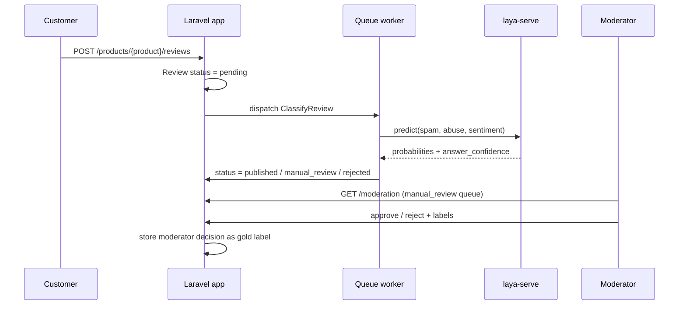

# ModQueue — review moderation for Laravel

> Project 4 of 5 in my [LayaPHP learning roadmap](../ROADMAP.md) — **Fase 4: Laravel + human-in-the-loop**.
> Status: **spec only**. The Laravel 13 app gets created step by step in this phase
> (`composer create-project laravel/laravel .`), so every generated file is understood.

A small shop app where customers post product reviews. Every review is classified in a queued job by a
self-hosted Laya model, confident decisions are applied automatically, and uncertain ones land in a moderator
dashboard. Every moderator decision is stored as a new labelled example, closing the loop back to `laya-eval`.

## Flow

## Data model

| Table | Key columns |
|---|---|
| `products` | name |
| `reviews` | product_id, body, lang (nullable), status (`pending`, `published`, `manual_review`, `rejected`), decided_by (`model` / `moderator`) |
| `review_classifications` | review_id, model checkpoint, answers (JSON: probabilities + answer_confidence per question), policy thresholds, latency_ms |
| `moderation_decisions` | review_id, user_id, decision, spam (bool), abuse (bool), sentiment, note |

Storing the raw answers and the thresholds used makes every automated decision auditable later.

## Building blocks

- **Reuse Project 1**: require `../01-review-moderator` through a Composer *path repository* and use its
  `ReviewQuestions` and `RoutingPolicy`, so the policy has one implementation and one test suite.
- **Laya in the container**: auto-discovered `LayaServiceProvider`, `config/laya.php`
  (`php artisan vendor:publish --tag=laya-config`), `.env`: `LAYA_URL`, `LAYA_API_KEY`, `LAYA_CACHE_STORE`, `LAYA_CACHE_TTL`.
- **`ClassifyReview` job** (`ShouldQueue`): injects `Laya`; `tries`/`backoff` for `ServerBusyException` and
  `TransportException`; `failed()` puts the review in `manual_review` with a reason. Never auto-publish on error.
- **Moderator dashboard** (Blade): manual-review queue sorted by lowest confidence first, model answers
  shown next to the review, approve/reject with spam/abuse/sentiment labels prefilled from the model.
  Access behind auth and a `moderate` gate.
- **Health**: `php artisan laya:health` in the deploy checklist; a `/up`-style health route that includes laya-serve.
- **Feedback export**: `php artisan modqueue:export-feedback ../datasets/reviews-feedback.csv` in the same
  columns as `datasets/reviews.csv` (`id,lang,text,spam,abuse,sentiment`), ready for `laya-eval` and fine-tuning.

## Tests (no model needed)

- `Laya::fake([...])` replaces the container binding, so the job and controllers get the fake automatically.
- `Queue::fake()` / `Bus::assertDispatched(ClassifyReview::class)` for the submit endpoint.
- Job tests for each outcome: publish, manual review (fake `null` answer = unsure), reject, server error → manual review.
- Dashboard: guests and non-moderators get 403; approve/reject writes a `moderation_decisions` row.

## Deployment on the VPS

- `database` queue driver + SQLite to start (no Redis needed), Redis later for cache.
- nginx + php8.4-fpm; `supervisor` keeps `php artisan queue:work --tries=3` running.
- laya-serve stays on `127.0.0.1:8000`; only nginx is public.

## Acceptance criteria

- [ ] A submitted review changes status automatically within seconds; uncertain ones appear in the dashboard.
- [ ] A laya-serve outage never publishes anything automatically.
- [ ] Feature tests green without laya-serve; Pint + PHPStan (Larastan) clean.
- [ ] The feedback CSV evaluates in `laya-eval`, and the result is in this README.

## What I learned

_todo_
